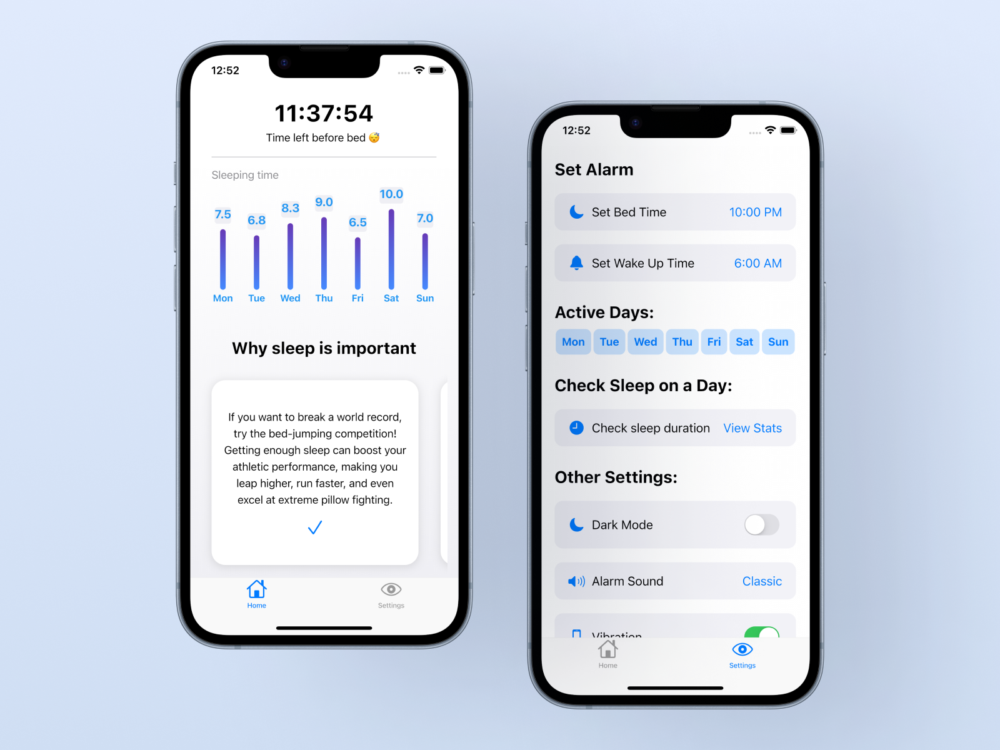

# sleep-tracker
This sleep tracking app helps users improve their sleep quality with features for setting bed and wake-up times, tracking sleep by day of the week, and analyzing sleep duration. There are also helpful tips on the importance of sleep and an option to enable night mode.

## Build

$ flutter pub get

$ flutter run 

## Preview

Push notifications. Local storage. User's theme support

